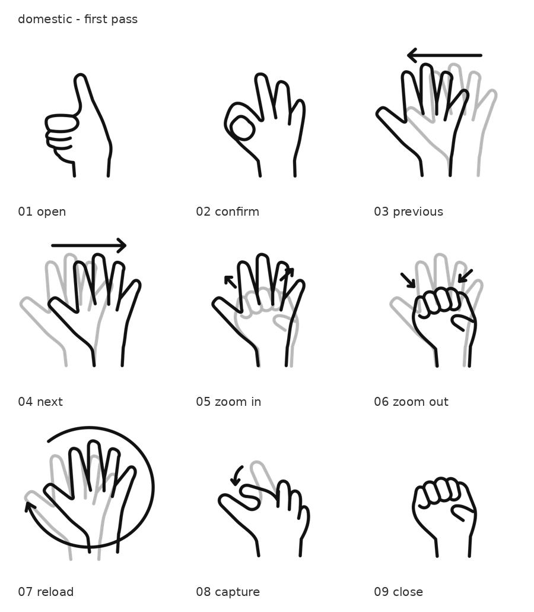
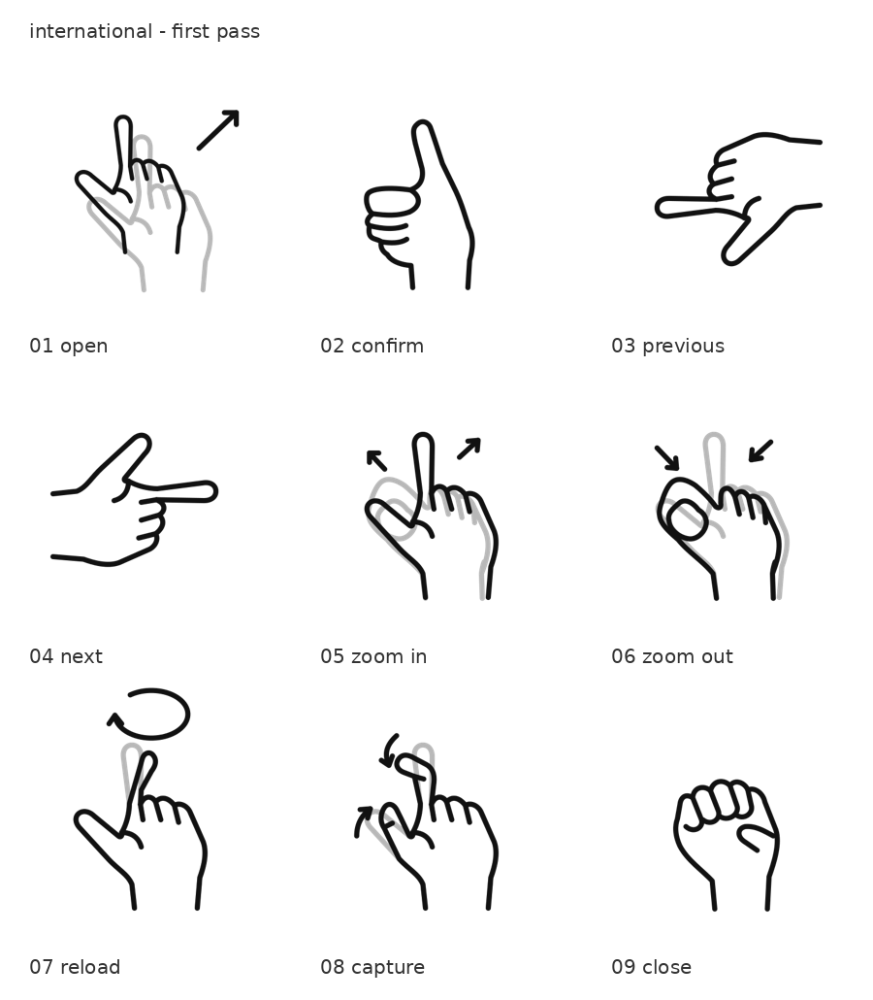

# MR Gesture Icons｜混合實境手勢圖示

將本國組與非本國組的研究手勢，重新繪製成一致、圓潤、簡化的黑白 SVG，供論文、簡報與手勢教學使用。

**目前為整套第一版，尚未定稿。** 兩組各 9 張完整示意，共 18 張；動態手勢另提供起始與結束姿態，共 40 個獨立 SVG。先完成整體，再精修複雜指節、動作幅度與視角。圖示完成度由研究者審查，不以文件數量當作驗證結果。

## 組別與資料夾

| 資料夾 | 內容 |
|---|---|
| `domestic/` | 本國組指令集；原九宮格 |
| `international/` | 非本國組指令集；原黃色表格，另參照真實手勢教學照片 |
| `references/` | 兩組原圖、簡報風格參考與來源紀錄 |
| `previews/` | 審查用 PNG 總覽，不是已確認的正式平面成品 |
| `tools/` | 可重建圖示的製作腳本與原始路徑 |

兩組使用相同指令編號。相同手勢共用同一份手型路徑，再依指令命名輸出至各組資料夾，例如本國組的開啟與非本國組的確認都使用比讚。

## 指令順序與手勢對照

| 編號 | 指令 | 檔名 | 本國組 domestic | 非本國組 international |
|---|---|---|---|---|
| 01 | 開啟 | `open` | 比讚 | 食指向前推動 |
| 02 | 確認 | `confirm` | OK 手勢 | 比讚 |
| 03 | 上一步 | `previous` | 整隻手向左移動 | 食指指向左 |
| 04 | 下一步 | `next` | 整隻手向右移動 | 食指指向右 |
| 05 | 放大 | `zoom-in` | 手掌展開 | 拇指與食指展開 |
| 06 | 縮小 | `zoom-out` | 手掌收合 | 拇指與食指捏合 |
| 07 | 重播 | `reload` | 手掌順時針畫圈 | 食指順時針畫圈 |
| 08 | 截圖 | `capture` | 手指捏合，依研究者指定沿用先前截圖手型 | 拇指與食指各彎一個指節，半捏合快門 |
| 09 | 關閉 | `close` | 握拳 | 握拳 |

此表依研究者的最新動作說明整理，補充說明優先於容易誤讀的原始符號。非本國組開啟的手型參照第二次實驗教學照片，原黃色表格只標示向前，仍待研究者核對。順時針以圖中可見方向呈現。

## 檔案命名與篩選

格式：**`指令編號-指令名稱-圖片編號-用途.格式`**。小寫英文字母、連字號、固定兩位指令編號。

| 圖片編號 | 用途 | 檔名範例 | 紙本使用 |
|---|---|---|---|
| 0 | 完整示意 `complete` | `08-capture-0-complete.svg` | 定稿後可直接插入文件 |
| 1 | 起始姿態 `start` | `08-capture-1-start.svg` | 適合另行排列或製作動態說明 |
| 2 | 結束姿態 `end` | `08-capture-2-end.svg` | 單獨不一定完整表意 |

- 靜態手勢只提供 `0-complete`。
- 動態手勢提供 `0-complete`、`1-start`、`2-end`。
- 依檔名排序，兩組的指令順序一致，每個指令先出現完整圖。
- 篩選 `-complete.svg`，即可取得全套 18 張完整示意。
- `complete` 表示能在單張圖中交代手勢，包含動態動作的合併示意，不表示動作一定是靜態。

例如 `domestic/04-next-0-complete.svg` 與 `international/04-next-0-complete.svg` 使用相同指令名稱，手勢依組別不同。

## 第一版總覽

### 本國組 domestic

### 非本國組 international

這些是審查預覽，圖片中的標題與指令名稱只存在於總覽，獨立 SVG 不含文字或外框。

## 繪圖方式與規範

**照片是骨架與動作的參考，圖示沿用共同建立的簡化手型。** 依照片辨識指根、關節、彎曲方向及前後姿態，再套回同一套圓潤輪廓。合併圖由繪製者整理，避免照搬拍攝透視、遮擋、鏡頭變形或不好看的外輪廓。

| 元素 | 規範 |
|---|---|
| 手部 | 右手，簡化比例，保留必要手指分界 |
| 畫布 | `viewBox="0 0 320 320"`，透明背景 |
| 手部與箭頭 | 6 個 SVG 座標單位，圓角端點與轉角；同一群組縮放後維持相同比例 |
| 起始姿態 | 淺灰 `#B8B8B8` |
| 結束姿態 | 黑色 `#111111` |
| 分開的姿態 | start/end 單獨輸出都用黑色，便於重新排版 |
| 箭頭 | 簡化直線或順時針弧線，與手部同粗細 |
| 完整動態圖 | 同一畫布合併灰色起始、黑色結束與方向箭頭 |
| 其他 | 不含指令文字、外框、指甲、掌紋、陰影或裝飾 |

SVG 使用真正的線段與 Bézier 曲線，沒有嵌入點陣圖片。動態圖包含 `start`、`end`、`motion` 群組。穩定的輪廓重疊時由黑色覆蓋灰色，移動的部位保留灰色殘影。

## SVG 與正式 PNG

**先確認 SVG，再另存正式 PNG。** PNG 和 SVG 同名，僅更換副檔名。

| 向量原檔 | 對應平面版 |
|---|---|
| `08-capture-0-complete.svg` | `08-capture-0-complete.png` |

正式 PNG 預計為透明背景、1920 × 1920 px。SVG 保留可編輯路徑；PNG 供紙本排版及不支援 SVG 的軟體使用。本輪只提供 SVG 與審查總覽，尚未輸出正式 PNG。

## 待精修項目

| 圖示 | 第一版表達 | 後續精修 |
|---|---|---|
| 非本國組截圖 | 拇指與食指各彎一個指節 | 指節位置、彎曲幅度與兩指間距 |
| 非本國組重播 | 手掌固定，以灰黑食指姿態與箭頭表示畫圈 | 指根與指尖軌跡；目前為示意相位，並非照片量得的精確動作端點 |
| 非本國組開啟 | 食指向前；縮放與斜向箭頭輔助表達深度 | 深度是否清楚、前後手型是否符合實際操作 |
| 放大／縮小 | 區分整隻手掌與兩指開合 | 前後姿態對齊、收合幅度與輪廓重疊 |
| 本國組截圖 | 沿用研究者指定可用的先前樣圖 | 必要時再確認接觸程度；不自動改成非本國組的一指節版本 |

必要時由研究者補拍特定角度或前後動作，繪製者先指出缺少的資訊，不要求無目的地重拍整套。單張照片沒有交代的動作相位，在第一版中屬示意，需經研究者核對。

## 由誰繪製、使用什麼模型

- **研究與手勢定義：** 謝祥紫提供兩組資料、真實手勢參考與動作說明，確認研究意義與最終圖示。
- **繪製協助：** OpenAI Codex（GPT-6.1 Sol）。
- **製作方式：** AI 助理直接編寫 SVG 路徑、群組與合併圖，設計共用手型及動作符號。首輪線條參考研究簡報的簡化、圓角風格，圖示使用新編寫的向量路徑。
- **工具：** Python 寫入 SVG/XML；Inkscape 渲染預覽。沒有使用 ImageGen 或點陣圖片生成模型。
- **檢查：** 檢查 SVG/XML 結構、共用畫布及沒有嵌入點陣圖，再渲染並目視檢查。人體結構與實際動作仍需研究者逐圖確認，渲染通過不等於手勢已正確。

論文中可在實際完成確認後揭露：「手勢示意圖由研究者提供動作定義，使用 OpenAI Codex（GPT-6.1 Sol）協助編寫 SVG 向量路徑，並經研究者確認與修訂。」

## 參考與製作原始碼

| 項目 | 用途 |
|---|---|
| `references/domestic-grid.jpg` | 原始 204.jpg，本國組九宮格 |
| `references/international-table.jpg` | 原始 203.jpg，非本國組黃色表格 |
| `references/style-reference.md` | 研究簡報來源及抽出的原始 SVG 風格參考 |
| [第二次實驗開始前說明](https://hackmd.io/vlS1KejZR96oRrO-DFbUiA) | 研究者提供的真實手勢照片，輔助辨識骨架與動作 |
| `tools/build_icons.py` | 重建兩組第一版 SVG；依賴共用靜態手型腳本 |
| `tools/build_static_samples.py` | 共用比讚、OK 的路徑與首輪靜態樣圖 |

重建：`python3 tools/build_icons.py`。總覽需另外使用 Inkscape 渲染。較早的動態樣圖已被本版取代，仍可從 Git 歷史查閱。儲存庫保持私人，尚未另行指定圖示或參考資料的公開授權。
