# MR Gesture Icons｜混合實境手勢圖示

兩組研究手勢的對應圖片，供簡報與紙本文件使用。提供兩組共 18 張解剖線稿 PNG（`realistic-`）。

| 資料夾 | 組別 |
|---|---|
| `domestic/` | 本國組，原九宮格 |
| `international/` | 非本國組，原黃色表格 |

## 指令對照

下表直接引用兩組的同名 PNG；圖片更新後，這裡同步顯示新版。雙姿態動態圖以左側灰線為起始姿態、右側黑線為結束姿態，兩姿態分開呈現；重播以單一右手搭配順時針箭頭表示。

| 編號 | 指令／檔名 | 本國組 | 非本國組 |
|---|---|---|---|
| 01 | 開啟 `open` |    拇指伸直朝上，其餘四指收合 | 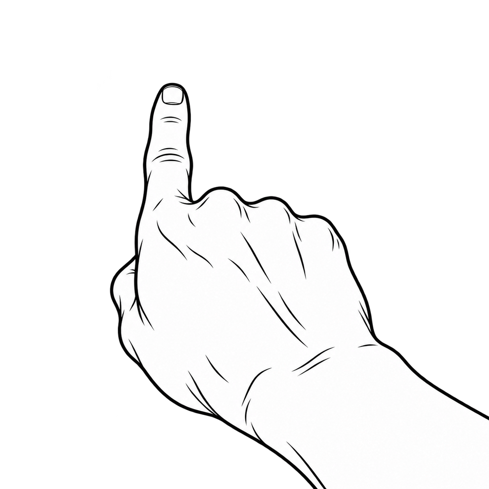   食指靜態指向前方，其餘四指收合（手背側） |
| 02 | 確認 `confirm` | 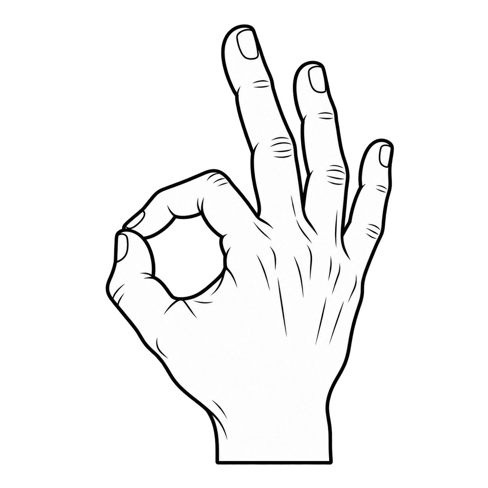   拇指與食指接觸成圈，其餘三指伸出 |    拇指伸直朝上，其餘四指收合 |
| 03 | 上一步 `previous` | 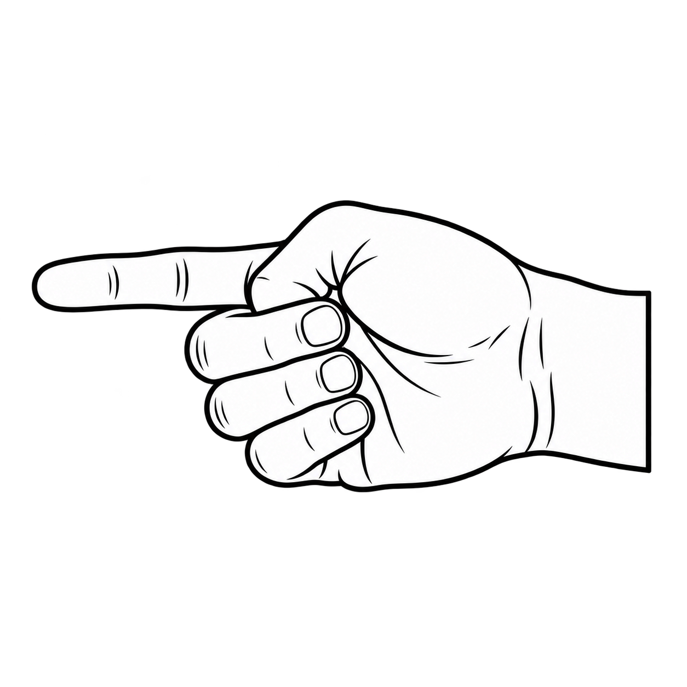   食指向左伸直，其餘四指收合（掌側） |    食指向左伸直，其餘四指收合（掌側） |
| 04 | 下一步 `next` | 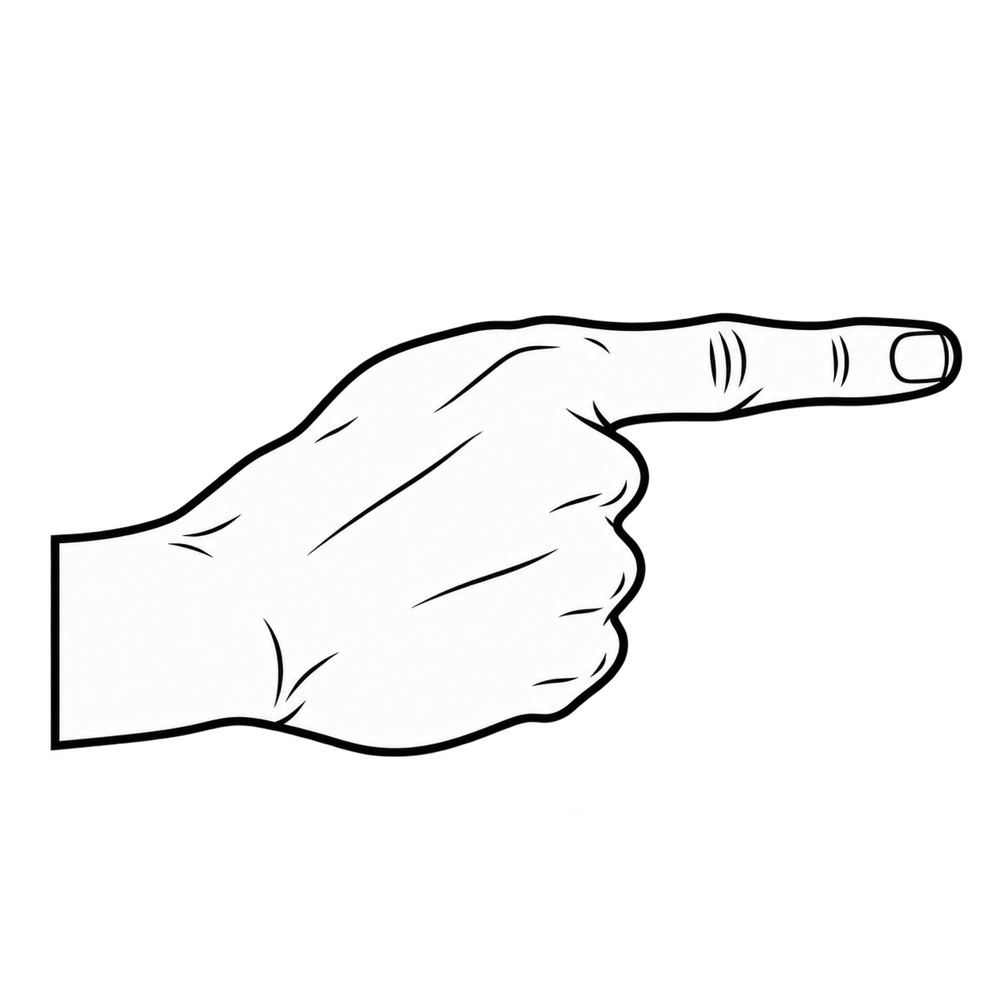   食指向右伸直，其餘四指收合（手背側） |    食指向右伸直，其餘四指收合（手背側） |
| 05 | 放大 `zoom-in` | 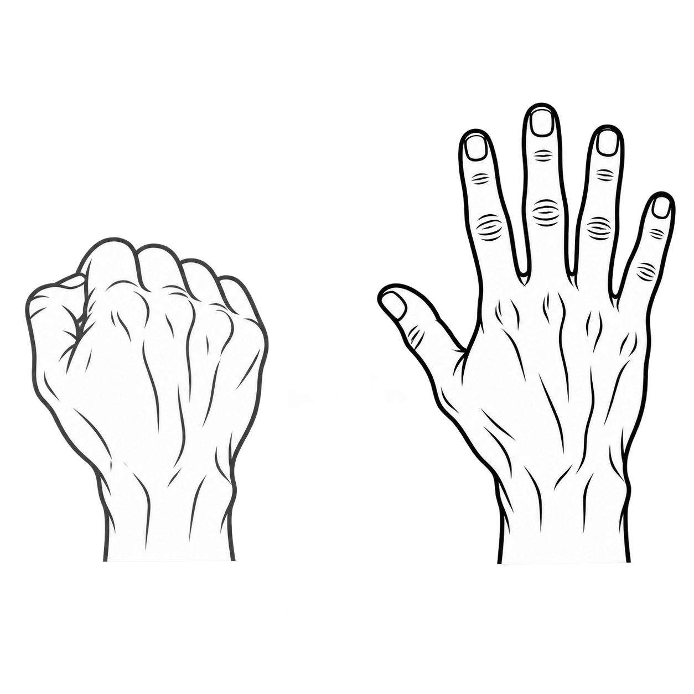   五指由收合逐漸張開（手背朝自己，拇指在左側） | 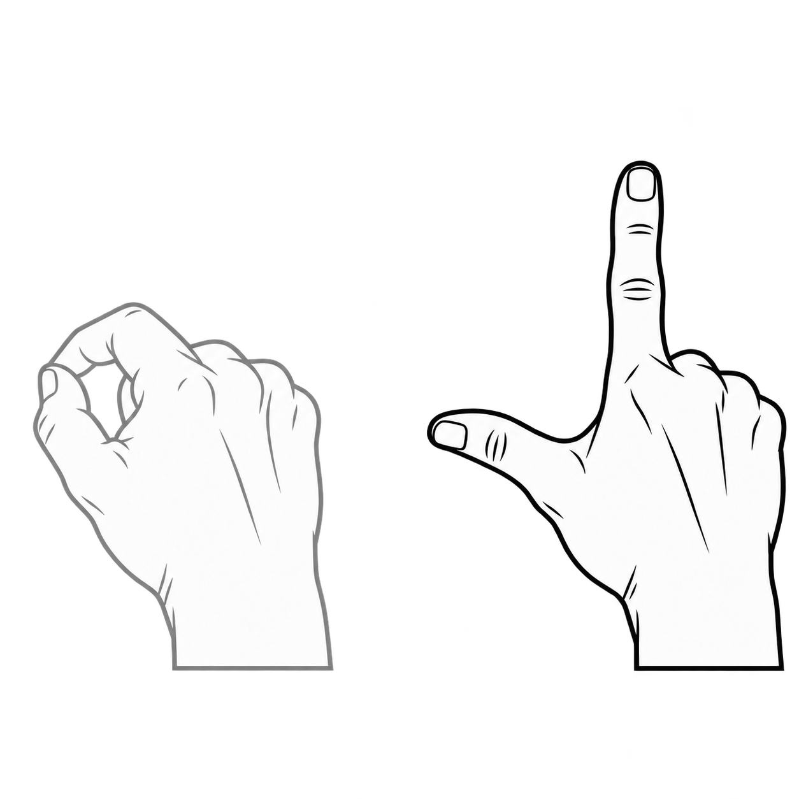   拇指與食指由接觸分開，其餘三指收合 |
| 06 | 縮小 `zoom-out` | 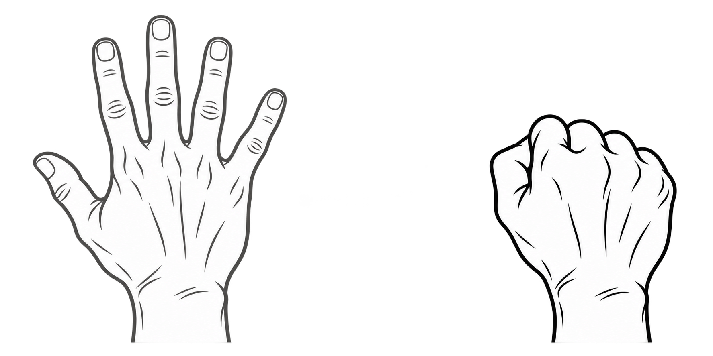   五指由張開逐漸收合（手背朝自己，拇指在左側） | 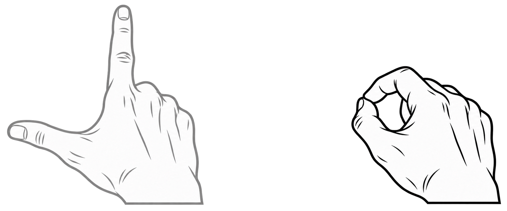   拇指與食指由分開到接觸，其餘三指收合 |
| 07 | 重播 `reload` | 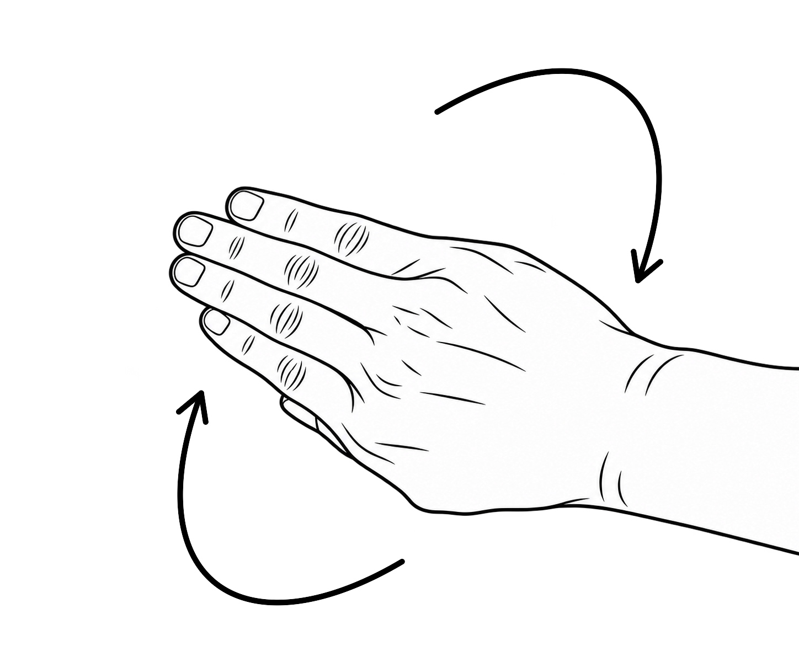   整手伸展，沿順時針軌跡畫圈；單一右手與同一透視橢圓上的兩段順時針弧箭頭（保留兩處缺口） | 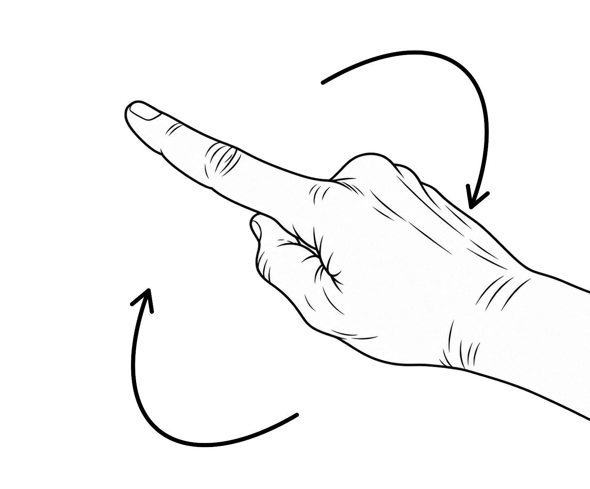   其餘手指收合，食指順時針畫圈（手背側）；單一右手與同一透視橢圓上的兩段順時針弧箭頭（保留兩處缺口） |
| 08 | 截圖 `capture` | 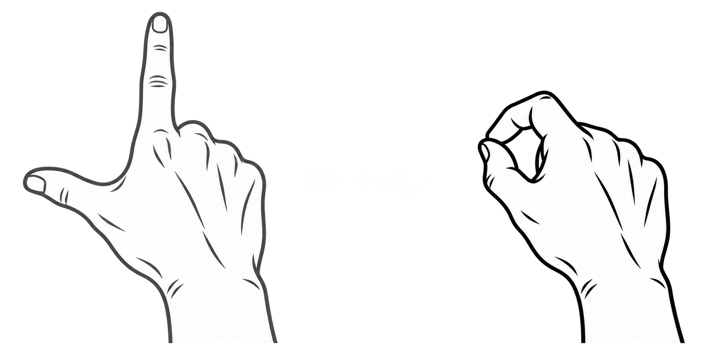   拇指與食指由分開到接觸捏合，其餘三指收合 | 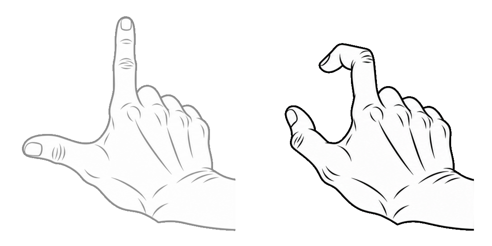   依實拍：食指前端下彎、拇指前端內彎，保留明顯開口且指尖不接觸；其餘三指收合 |
| 09 | 關閉 `close` | 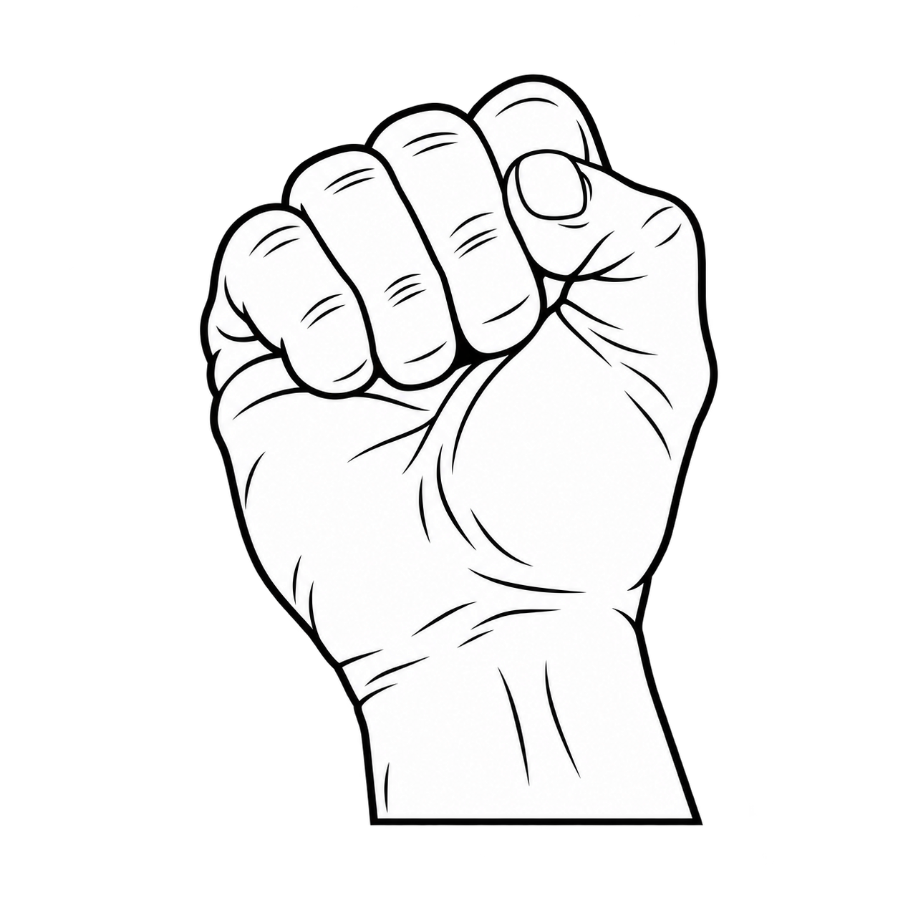   五指收合成拳 |    五指收合成拳 |

## 命名原則

格式：`兩位指令編號-指令名稱-圖片編號-用途.svg`。兩組使用一致的指令順序。

| 後綴 | 用途 |
|---|---|
| `-0-complete.svg` | 完整表意；新版 PNG 動態手勢左右分開呈現前後姿態；僅重播保留旋轉箭頭 |
| `-1-start.svg` | 動態手勢的起始姿態 |
| `-2-end.svg` | 動態手勢的結束姿態 |

例如 `08-capture-0-complete.svg`。篩選 `-complete.svg` 可取得兩組共 18 張完整圖；連同動態拆分版本，共 34 張 SVG。

新版 PNG 使用 `realistic-兩位編號-指令名稱-0-complete.png`，放在 `domestic/realistic/` 與 `international/realistic/`。兩組各 9 張，透明外背景、白色手部內底。原 SVG 與舊 PNG 保留供追溯。

## 製作方式

依研究者提供的原九宮格（本國組）、黃色表格（非本國組）與 [HackMD 實拍](https://hackmd.io/vlS1KejZR96oRrO-DFbUiA) 核對。統一使用本人看自己右手的第一人稱視角，逐張核對掌背面與拇指位置。

`realistic-` 為解剖線稿 PNG，以研究者重附的五張產圖為風格基準，補圖使用 OpenAI imagegen。左側灰線表示起始姿態、右側黑線表示結束姿態，動態圖在同一畫布左右分開，左灰表示先比的姿態、右黑表示後比的姿態；不使用表示前後順序的向右箭頭；重播依研究者實拍右手呈現單一姿態，手腕帶動整手旋轉，使用同一透視橢圓上的兩段順時針弧箭頭，保留兩處缺口，黑線描白邊；開放式尖端與弧線相連，不使用實心三角形。PNG 具有透明外背景與白色手部內底。原 SVG 與舊 PNG 保留供追溯，README 預覽引用新版本。

解剖線稿 PNG 位於 `domestic/realistic/` 與 `international/realistic/`，與各組 `png/` 資料夾同層。

## GIF 動態試作

GIF 與同名 PNG 並存，不覆蓋靜態版本。這版以四個關鍵姿態示範動作，透明外背景、白色手部內底；手腕位置對齊。放大／縮小結束停留 1 秒，短暫留白後重新播放，避免反向回程混淆指令。外國截圖每圈只收合一次，在食指與拇指各折一個指節、指尖保持分開的姿態停留 1 秒後直接重置至起始姿態；不播放展開的回程。

| 指令 | 本國 | 外國 |
| --- | --- | --- |
| 放大 | 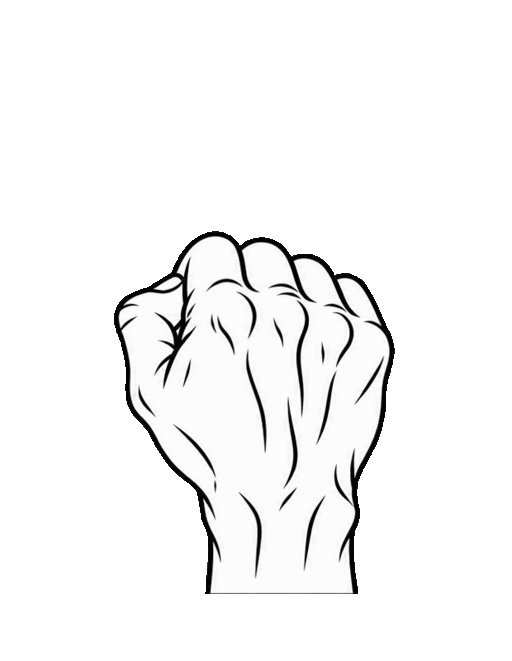 | 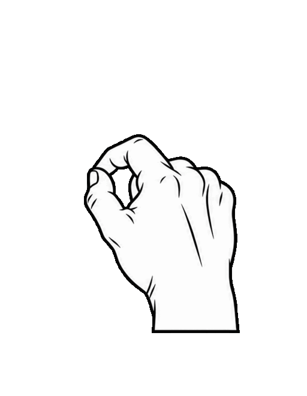 |
| 縮小 | 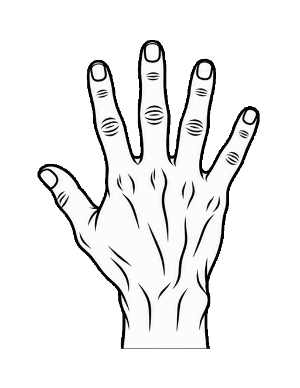 | 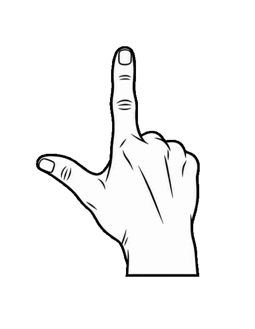 |
| 重播 | 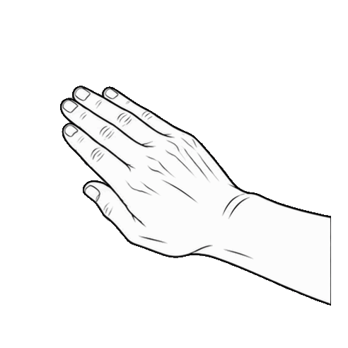 | 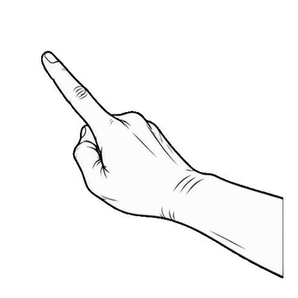 |
| 截圖 | — | 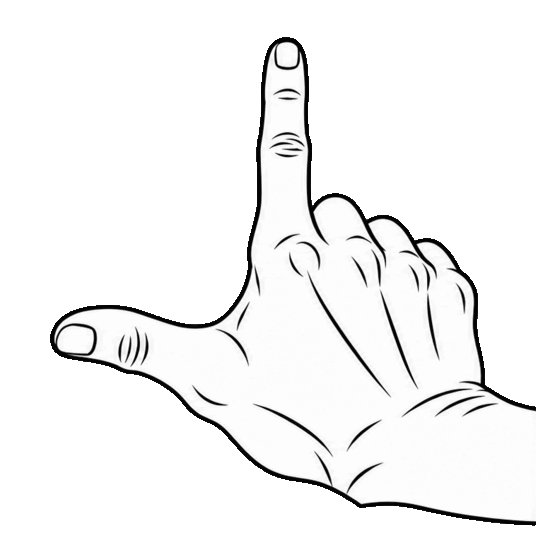 |

姿態影格以 OpenAI imagegen 製作，使用既有 PNG 作為右手結構及線稿風格參考，再將影格對齊並編碼為 GIF。

重播 GIF 依兩段實拍影片的一圈連續動作製作，保留完整的手掌、手腕與前臂輪廓，允許前臂小幅隨動，不再接上固定前臂。9 個姿態依序播放，包含依實拍補上的掌面／手側上翻影格，每格 180 毫秒；結尾回到與開頭完全相同的角度與影格，停留 450 毫秒後開始下一圈，不反向倒播。本國從手背側角度開始，外國從食指伸出的角度開始。動圖無箭頭，靜態 PNG 保留原有箭頭。這版仍為關鍵姿態試作。

外國截圖 PNG 與 GIF 依 `VID_20261011_173609.mp4` 的確認姿態重畫，兩者使用同一組影格。食指直立部分保留，前端彎曲；拇指前端往內彎，兩指保留明顯間距。PNG 左灰為起始、右黑為完成；GIF 起始停留 900 毫秒，以 60 毫秒過渡快速收合一次，完成停留 1 秒後直接重置，不把展開當成指令動作。

外國截圖 PNG 與 GIF 依 `VID_20261011_173609.mp4` 的確認姿態重畫，兩者使用同一組影格。食指直立部分保留，前端彎曲；拇指前端往內彎，兩指保留明顯間距。PNG 左灰為起始、右黑為完成；GIF 起始停留 900 毫秒，以 60 毫秒過渡快速收合一次，完成停留 1 秒後直接重置，不把展開當成指令動作。
