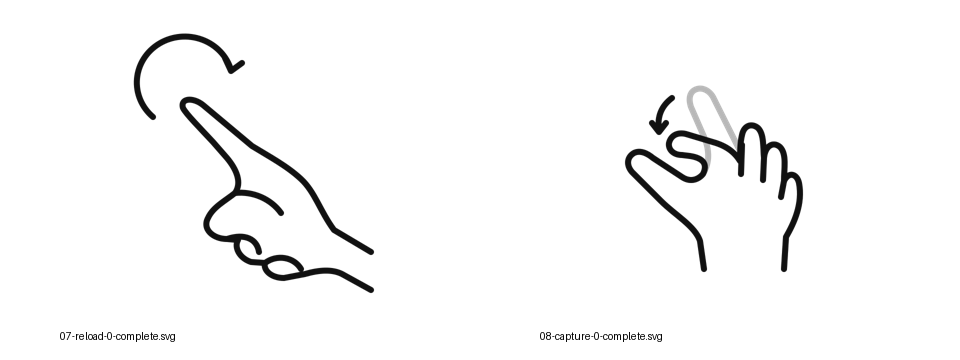

# MR Gesture Icons｜混合實境手勢圖示

以兩組研究指令集為基礎，重新繪製風格一致、可編輯的黑白 SVG，供論文、簡報與手勢操作說明使用。相同指令可能使用不同手勢，圖示以實際姿態和動作為準。

**目前進度：首輪樣圖，尚未定稿。** 已繪製非本國組的僅食指順時針畫圈、半捏合快門，快門樣圖提供完整示意、起始姿態與結束姿態；畫圈樣圖依真實照片先提供單一手型與順時針箭頭，分開姿態待補充實際動作後繪製。其餘圖示將依樣圖回饋接續繪製。

## 組別與資料夾

| 資料夾 | 組別 | 原始參考 |
|---|---|---|
| `domestic/` | 本國組 | 九宮格手勢圖 |
| `international/` | 非本國組 | 黃色表格 |
| `references/` | 原始資料與風格參考 | 兩組圖片、研究簡報 |
| `previews/` | 審查用預覽與總覽 | 非正式 PNG 成品 |
| `tools/` | 可重建 SVG 的製作腳本 | 原始路徑與輸出邏輯 |

兩組共用相同指令編號。實際手勢相同時沿用同一圖形，分別輸出至各組資料夾，避免重複繪製或產生風格差異。資料夾名稱只用於識別組別，不改變研究中的正式組別定義。

## 指令順序與手勢對照

以下依提供的兩組資料與研究者補充整理。使用者的動作說明優先於原圖中容易誤讀的符號；這是繪圖對照，不代表兩組動作已通過新的實驗驗證。

| 編號 | 指令 | 檔名用字 | 本國組 domestic | 非本國組 international |
|---|---|---|---|---|
| 01 | 開啟 | `open` | 比讚 | 向前推動；具體手型待確認 |
| 02 | 確認 | `confirm` | OK 手勢 | 比讚 |
| 03 | 上一步 | `previous` | 整隻手向左移動 | 手指指向左 |
| 04 | 下一步 | `next` | 整隻手向右移動 | 手指指向右 |
| 05 | 放大 | `zoom-in` | 手掌展開 | 拇指與食指展開 |
| 06 | 縮小 | `zoom-out` | 手掌收合 | 拇指與食指捏合 |
| 07 | 重播 | `reload` | 手掌順時針畫圈 | 食指順時針畫圈 |
| 08 | 截圖 | `capture` | 手指完整捏合 | 手指半捏合，像按下快門 |
| 09 | 關閉 | `close` | 握拳 | 握拳 |

「手指指向」目前按方向姿態整理；是否需要表達額外的手指移動，應依研究者後續確認。「順時針畫圈」目前按畫面中可見的圓形運動軌跡呈現，不表示手指繞自身長軸旋轉。手掌畫圈的具體視角與旋轉軸仍須在繪製時核對。

## 檔案命名

採用 **`指令編號-指令名稱-圖片編號-用途.格式`**，全部使用小寫英文字母與連字號。

| 圖片編號 | 用途 | 範例 | 紙本使用 |
|---|---|---|---|
| 0 | 完整示意 `complete` | `08-capture-0-complete.svg` | 是，定稿後可直接插入文件 |
| 1 | 起始姿態 `start` | `08-capture-1-start.svg` | 單獨不一定能完整表意 |
| 2 | 結束姿態 `end` | `08-capture-2-end.svg` | 單獨不一定能完整表意 |

- 靜態手勢只提供 `0-complete`。
- 動態手勢提供 `0-complete`、`1-start`、`2-end`。
- 依檔名排序，兩組都按同一指令順序排列，每個指令先顯示完整示意。
- 搜尋或篩選 `-complete.svg`，即可選出 SVG 完整示意；正式使用前仍需確認圖示已定稿。
- `complete` 是完整的單張動作說明，並非動作一定是靜態。

範例：`domestic/04-next-0-complete.svg` 與 `international/04-next-0-complete.svg` 指向同一指令，但手勢內容依組別不同。

## 繪圖規範

| 元素 | 規範 |
|---|---|
| 手部 | 右手，簡化輪廓，保留辨識所需的手指分界 |
| 畫布 | 共用 `viewBox="0 0 320 320"`，透明背景 |
| 手部線條 | 6 個 SVG 座標單位，圓角端點與轉角 |
| 動態箭頭 | 6 個 SVG 座標單位，與手部相同粗細，黑色、簡化開放式箭頭 |
| 起始姿態 | 淺灰 `#B8B8B8` |
| 結束姿態 | 黑色 `#111111` |
| 分開姿態 | 單獨的 start/end 都使用黑色，方便另行排版 |
| 完整圖 | 起始灰色、結束黑色，搭配方向箭頭 |
| 其他內容 | 不含指令文字、外框、掌紋、指甲或裝飾性陰影 |

SVG 中以 `start`、`end`、`motion` 群組分開編輯。部分重疊的穩定輪廓會由黑色線條覆蓋灰色線條，讓移動的手指更容易辨識。靜態姿態不刻意添加動態箭頭。

## SVG 與 PNG

**先確認 SVG，再另存正式 PNG。** PNG 與 SVG 同名，僅替換副檔名。例如：

- `08-capture-0-complete.svg`
- `08-capture-0-complete.png`

正式 PNG 保留透明背景，預計以 1920 × 1920 px 輸出，供紙本排版與不支援 SVG 的軟體使用。SVG 為可編輯原檔，PNG 為平面輸出。`previews/` 中的 PNG 僅供審查，不代表已確認或已另存正式 PNG。

## 首輪樣圖

2026-10-10 修訂：食指畫圈改為手掌與其餘手指固定，只以灰黑兩種食指姿態呈現動作；兩張樣圖的箭頭線寬均調整為與手部相同的 6 單位。

| 手勢 | 完整圖 | 起始 | 結束 |
|---|---|---|---|
| 非本國組：食指順時針畫圈 | [完整 SVG](international/07-reload-0-complete.svg) | 待實際動作確認 | 待實際動作確認 |
| 非本國組：半捏合快門 | [完整 SVG](international/08-capture-0-complete.svg) | [起始 SVG](international/08-capture-1-start.svg) | [結束 SVG](international/08-capture-2-end.svg) |

2026-10-10 再修訂：依研究者提供的真實手勢照片改畫側面手型。原先的灰黑食指姿態有不自然的指根，因此撤下該版起始與結束圖；目前畫圈完整圖僅使用真實手型與順時針箭頭，避免推測動作端點。

本輪需確認：簡化程度、線寬、前後姿態的重疊、箭頭方向，以及半捏合是否符合實際動作。樣圖不代表整套九指令圖庫已完成。

## 由誰繪製、如何製作

- **研究手勢與需求：** 謝祥紫提供兩組參考資料、手勢動作說明，並確認研究意義與最終圖示。
- **繪製協助：** OpenAI Codex，GPT-6.1 Sol。
- **製作方式：** AI 助理直接編寫 SVG 的 Bézier 曲線、線段與群組，依參考資料重新設計手型、姿態與動作箭頭。這些首輪樣圖是新編寫的向量路徑，未直接複製原簡報的手勢路徑。
- **風格來源：** 使用者提供的研究簡報，參考其簡化輪廓與圓角線條，統一改為黑白灰。
- **生成工具：** Python 寫入 SVG/XML 原始碼；Inkscape 渲染審查預覽。沒有使用 ImageGen 或其他點陣圖片生成模型，也沒有將點陣圖嵌入 SVG。
- **品質檢查：** 檢查 SVG/XML 結構、確認沒有嵌入點陣圖，再渲染並目視檢查。動作意義與是否符合研究資料由研究者確認。

若論文需要揭露 AI 協助，可使用：「手勢示意圖由研究者提供動作定義，使用 OpenAI Codex（GPT-6.1 Sol）協助編寫 SVG 向量路徑，並經研究者確認與修訂。」此句僅能在實際完成確認與修訂後使用。

## 參考檔

| 檔案 | 來源與用途 |
|---|---|
| `references/domestic-grid.jpg` | 原始 204.jpg，本國組九宮格 |
| `references/international-table.jpg` | 原始 203.jpg，非本國組黃色表格 |
| `references/style-reference.md` | 原始研究簡報的來源紀錄與抽出的 SVG 風格參考 |

目前儲存庫為私人。尚未另行指定圖示或參考資料的公開授權。

## 真實手勢參考

研究者補充：[第二次實驗開始前說明](https://hackmd.io/vlS1KejZR96oRrO-DFbUiA)。已查看其中各指令的真實手部照片，以其姿態校正指根、拇指位置與彎曲方式。該頁屬第二次實驗的手勢教學，與原始黃色表格的分類可能有層次差異，不自動替換兩組全部對照。畫圈參考照片目前只有一個姿態及方向箭頭，不能從中確定完整的起始與結束動作。
