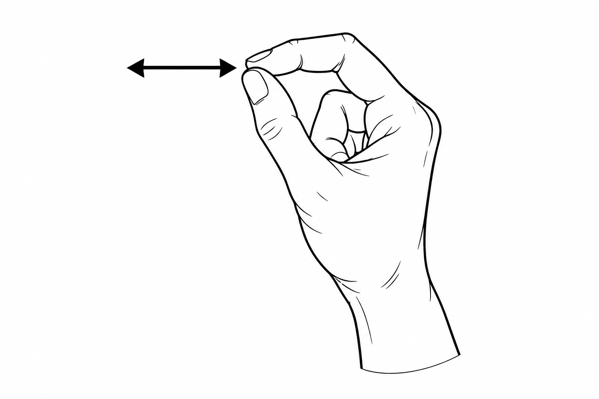
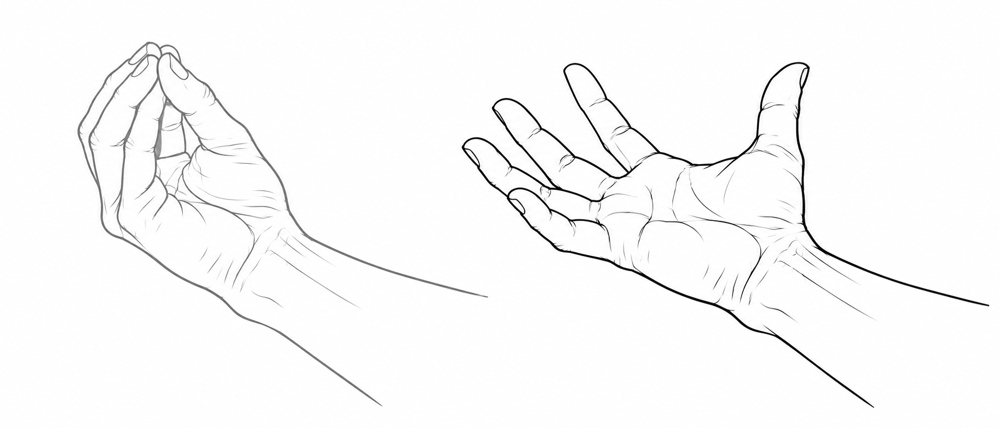
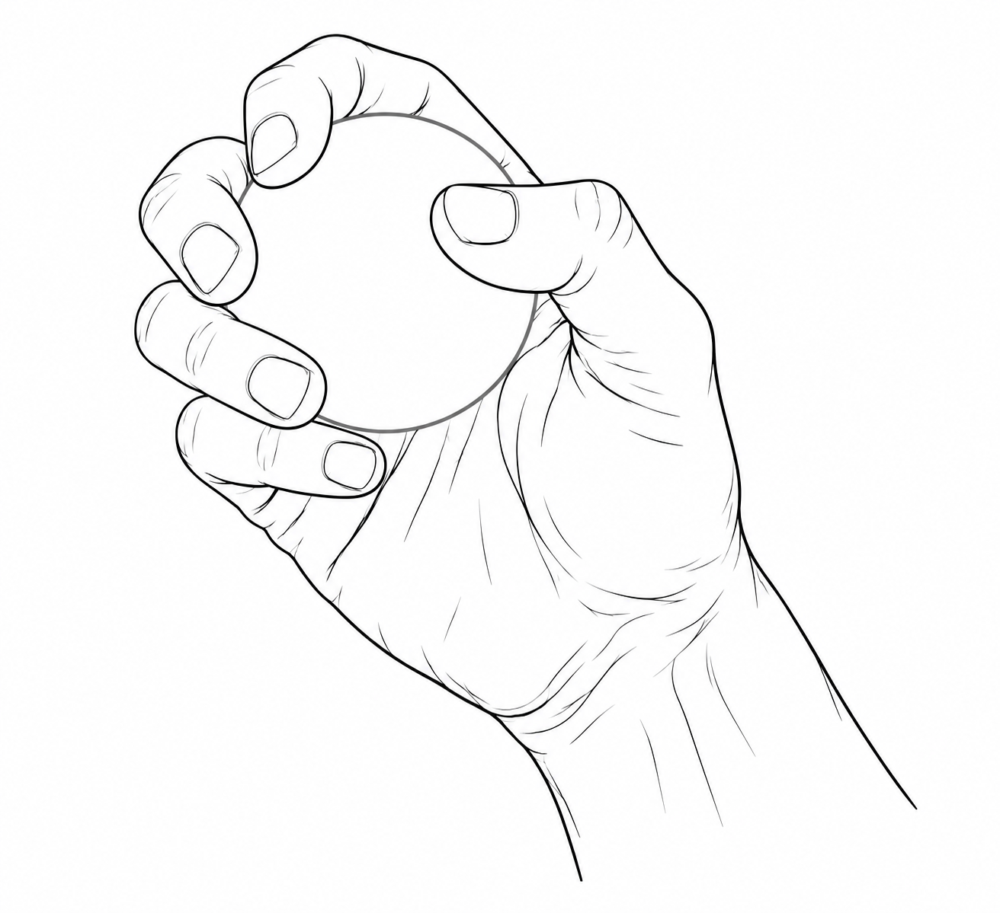

# 文獻與平台手勢圖示

2026-10-12 新增，與論文文獻探討表格使用的七張 PNG 相同。依官方互動說明，以 OpenAI imagegen 生成黑白解剖線稿；為研究者製作的動作示意圖，非官方原圖。白色背景、PNG 原始尺寸保留。

## 圖示預覽與使用對照

| 圖示 | 名稱 | 動作說明 | 文件中的對應 |
| --- | --- | --- | --- |
|  | 捏合 | 拇指與食指指尖接觸。單次點選、長按與連續兩次點選共用此姿態，時間差異由表格文字描述。 | HoloLens Air Tap／Tap and Hold；Meta Pinch；Apple Tap／Double Tap |
|  | 捏合拖曳 | 維持捏合並移動整隻手；雙向箭頭示意橫向移動。 | HoloLens Manipulation；Meta Pinch Drag；Apple Drag |
|  | 方向移動 | 維持捏合並移動整隻手；十字箭頭示意水平與垂直方向。 | HoloLens Navigation；Apple Scroll（示意移動方向） |
|  | Bloom | 掌心朝上，五指由指尖聚攏轉為張開；左灰為起始，右黑為結束。 | 初代 HoloLens Bloom |
|  | 整手抓握 | 手指環握示意虛擬球體，表達整手抓取物件。 | Meta Grab |
|  | 揮動 | 伸展的手掌橫向移動。 | Meta 應用程式自訂 Swipe |
|  | 雙手縮放 | 雙手捏合後以兩手距離變化表達縮放。 | Meta 應用程式縮放；Apple Zoom |

圖示呈現主要姿態與方向；各平台的觸發時間、注視條件與應用情境須搭配文字說明。Apple Scroll 使用方向移動圖表示整手移動，操作說明仍依 Apple 指南；Meta Swipe 與雙手縮放需由應用程式定義或配置。Bloom 僅對應初代 HoloLens。

## 參考來源

Microsoft. (2023, March 3). *Gaze and commit*. Microsoft Learn. https://learn.microsoft.com/en-us/windows/mixed-reality/design/gaze-and-commit

Microsoft. (2022, February 2). *Start gesture*. Microsoft Learn. https://learn.microsoft.com/en-us/windows/mixed-reality/design/system-gesture

Meta. (2026, April 6). *Grab*. Meta Horizon Developers. https://developers.meta.com/vr/design/grab_usage/

Meta. (2026, May 4). *Grab specs*. Meta Horizon Developers. https://developers.meta.com/vr/design/grab_specs/

Meta. (2026, August 17). *Hands interaction types*. Meta Horizon Developers. https://developers.meta.com/vr/design/hands-interaction-types/

Apple. (n.d.-a). *Gestures*. Apple Developer. https://developer.apple.com/design/human-interface-guidelines/gestures

Apple. (n.d.-b). *Learn basic gestures and controls on Apple Vision Pro*. Apple Support. https://support.apple.com/en-euro/guide/apple-vision-pro/tan1e2a29e00/visionos

Apple. (2026, September 28). *Use gestures with your Apple Vision Pro*. Apple Support. https://support.apple.com/en-ie/117741

