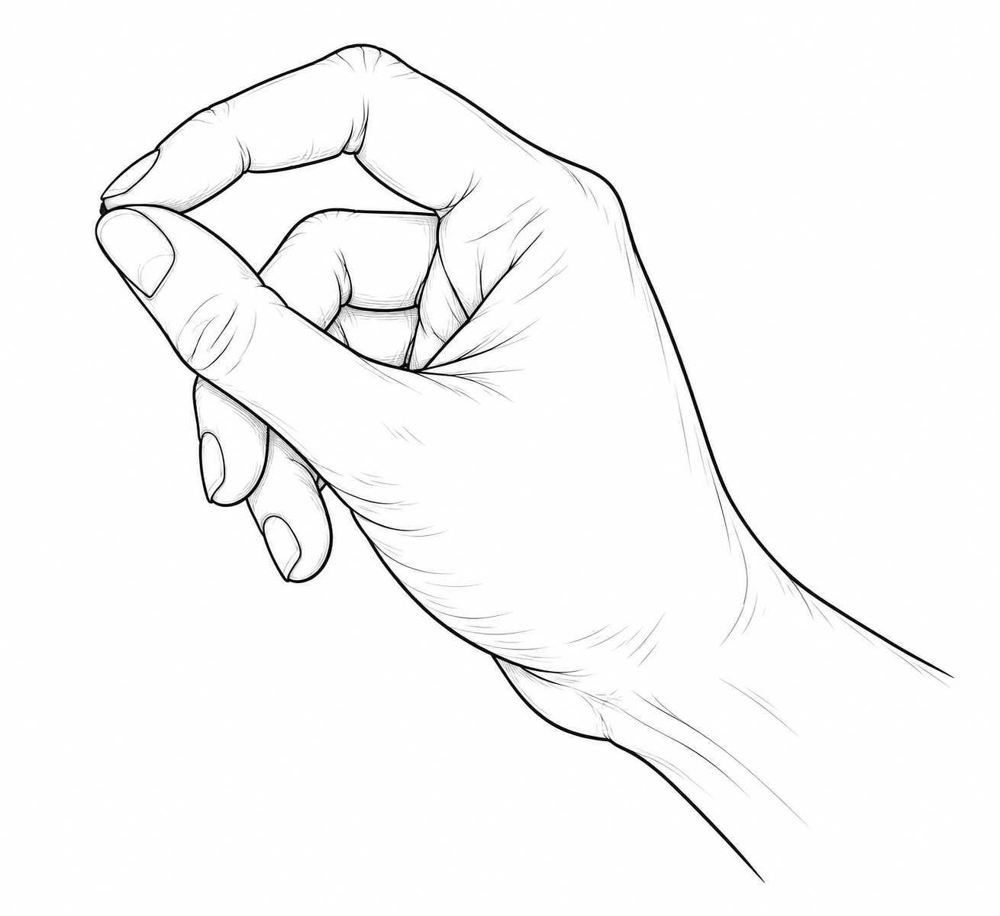
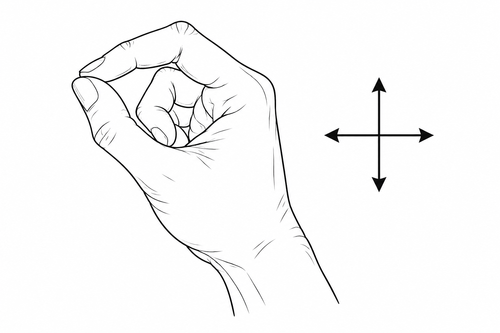
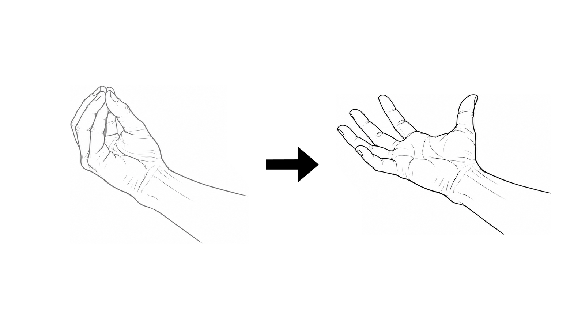
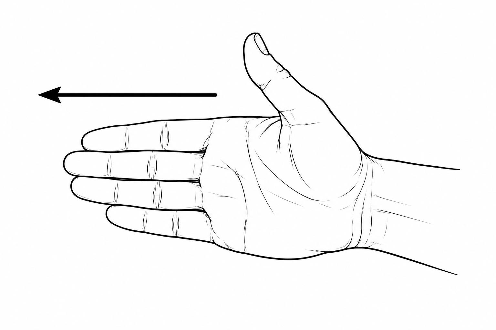
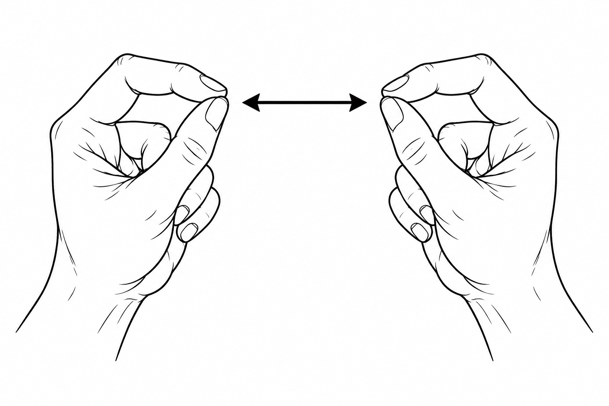

# 文獻與平台手勢圖示

依論文表格順序，分為三個品牌資料夾，每個資料夾包含五張 PNG。檔名格式：`兩位列序號-指令-品牌-realistic.png`；編號對應該表格資料列，由 01 起算。

| 論文表格 | 品牌 | 資料夾 |
| --- | --- | --- |
| 表 2-1 | Microsoft HoloLens | [hololens/realistic/](hololens/realistic/) |
| 表 2-2 | Meta Quest | [meta-quest/realistic/](meta-quest/realistic/) |
| 表 2-3 | Apple Vision Pro | [apple-vision-pro/realistic/](apple-vision-pro/realistic/) |

圖示為研究者依官方互動說明，以 OpenAI imagegen 製作的黑白解剖線稿，圖稿來源與 Word 表格相同。共 15 個按品牌與指令命名的檔案，使用七張原始圖稿；共用圖稿仍依各平台的指令分別命名，搭配文字表示觸發時序。PNG 保留白色背景；HoloLens Bloom 已依雙姿態排版規則調整為 1600 × 900，其餘圖片保留原始尺寸。

Bloom 的前後姿態使用等大配置區域、相近可見手部面積及固定中央間隔，中央使用捷運導引風格的粗實心向右箭頭。雙手縮放圖保留中央雙向箭頭，表示左右手同時移動。

## 表 2-1 Microsoft HoloLens

| 編號 | 指令 | 圖示 | 動作說明 |
| --- | --- | --- | --- |
| 01 | Air Tap |  | 捏合後放開 |
| 02 | Tap and Hold |  | 保持捏合 |
| 03 | Manipulation |  | 捏合後移動 |
| 04 | Navigation |  | 保持捏合後沿方向移動 |
| 05 | Bloom（初代） |  | 掌心朝上，五指聚合後展開 |

## 表 2-2 Meta Quest

| 編號 | 指令 | 圖示 | 動作說明 |
| --- | --- | --- | --- |
| 01 | Pinch |  | 捏合 |
| 02 | Pinch and Drag |  | 保持捏合並拖曳 |
| 03 | Grab |  | 整手抓握 |
| 04 | Swipe（應用程式自訂） |  | 橫向揮動 |
| 05 | Two-hand Scale |  | 雙手捏合後拉開或靠近 |

## 表 2-3 Apple Vision Pro

| 編號 | 指令 | 圖示 | 動作說明 |
| --- | --- | --- | --- |
| 01 | Tap |  | 注視後捏合 |
| 02 | Double Tap |  | 連續捏合兩次 |
| 03 | Drag |  | 保持捏合並拖曳 |
| 04 | Scroll |  | 保持捏合並上下移動整手 |
| 05 | Zoom |  | 雙手捏合後拉開或靠近 |

圖示呈現主要姿態與方向；各平台的觸發時間、注視條件與應用情境須搭配文字說明。Apple Scroll 的圖示表示整手移動方向；Meta Swipe 與雙手縮放需由應用程式定義或配置。Bloom 僅對應初代 HoloLens。

## 參考來源

Microsoft. (2023, March 3). *Gaze and commit*. Microsoft Learn. https://learn.microsoft.com/en-us/windows/mixed-reality/design/gaze-and-commit

Microsoft. (2022, February 2). *Start gesture*. Microsoft Learn. https://learn.microsoft.com/en-us/windows/mixed-reality/design/system-gesture

Meta. (2026, April 6). *Grab*. Meta Horizon Developers. https://developers.meta.com/vr/design/grab_usage/

Meta. (2026, May 4). *Grab specs*. Meta Horizon Developers. https://developers.meta.com/vr/design/grab_specs/

Meta. (2026, August 17). *Hands interaction types*. Meta Horizon Developers. https://developers.meta.com/vr/design/hands-interaction-types/

Apple. (n.d.-a). *Gestures*. Apple Developer. https://developer.apple.com/design/human-interface-guidelines/gestures

Apple. (n.d.-b). *Learn basic gestures and controls on Apple Vision Pro*. Apple Support. https://support.apple.com/en-euro/guide/apple-vision-pro/tan1e2a29e00/visionos

Apple. (2026, September 28). *Use gestures with your Apple Vision Pro*. Apple Support. https://support.apple.com/en-ie/117741

